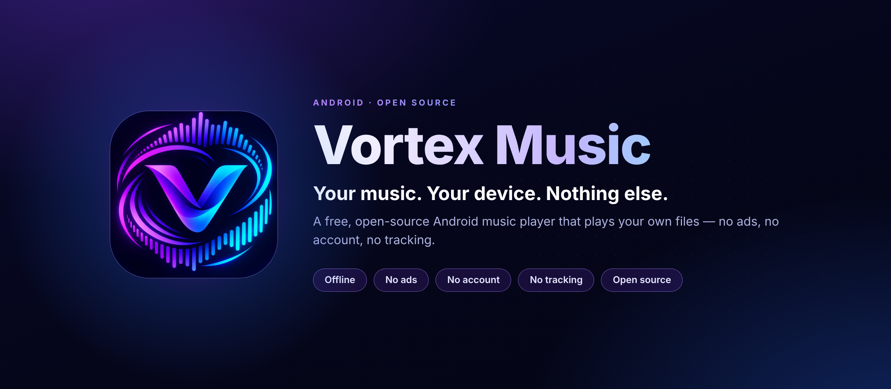
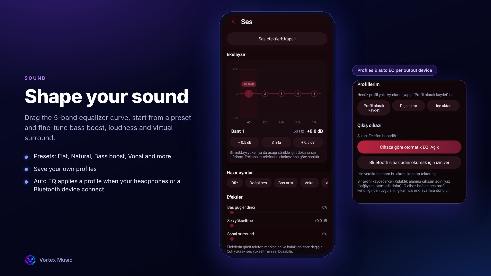
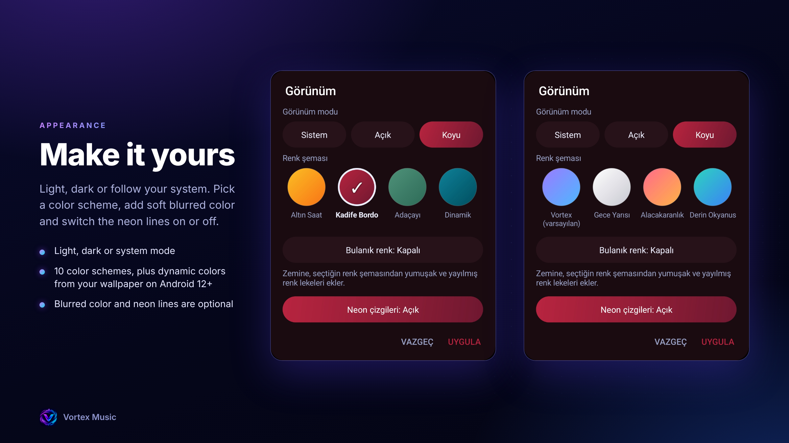

  

  <b>English</b> · <a href="README.tr.md">Türkçe</a>

# Vortex Music

A free, open-source Android music player for **your own music files**.
No ads, no account, no tracking. It works fully offline and doesn't even ask for internet permission.

[**Download the latest beta**](../../releases) · [Report a bug](../../issues)

> **Status:** Beta. The app interface is currently in Turkish. English, French, German and Italian are planned for Beta 2.

## Screenshots

## Features

- **Plays your own files**, with media notification and lock screen controls
- **Equalizer:** draggable 5-band curve, presets, bass boost, loudness boost and virtual surround
- **Automatic EQ:** save profiles and have them applied automatically when headphones or a Bluetooth device connects
- **Listening statistics:** today, this week, this month and all time, all calculated on your device
- **Appearance:** light, dark or system mode, many color schemes, dynamic colors on Android 12+, optional blur and neon lines
- **Library control:** many sort modes, six list and grid layouts, manual ordering that never touches your files
- **Duplicate finder** that locates multiple copies of the same song
- **Backup and restore** for likes, folders, covers and sorting
- **Remembers where you left off** when the app is closed

## Privacy

- No internet permission, no ads, no analytics, no account
- Your statistics and settings stay on your device
- The app only asks for what it needs: access to your music files, and optionally Bluetooth permission to read the output device name (for automatic EQ)

## Install

1. Open the [Releases](../../releases) page.
2. Download the `.apk` file under the latest release.
3. Open it on your phone. Android may ask you to allow installing from your browser or file manager.

### Automatic updates with Obtainium

[Obtainium](https://github.com/ImranR98/Obtainium) is a free app that tracks apps on GitHub and notifies you when a new version is released.

1. Install and open Obtainium.
2. In **Add app**, paste this repository's address (the address of this page in your browser).
3. Releases are currently **pre-releases (beta)**, so turn on **Include prereleases** on the add screen.
4. Tap **Add**. When a new version comes out, Obtainium tells you and you update with one tap.

## Roadmap

- **Beta 2:** English, French, German and Italian translations, lyrics, downloads, an About and What's new screen, more theme options
- **Later:** tag editing, more features

## Contributing

Bug reports and ideas are welcome. Open an [issue](../../issues) and include what happened, your phone model and your Android version.

## License

Released under the GPL-3.0 license. See [LICENSE](LICENSE).

<!-- README.tr.md: aynısı, sadece en yerine tr yaz -->

