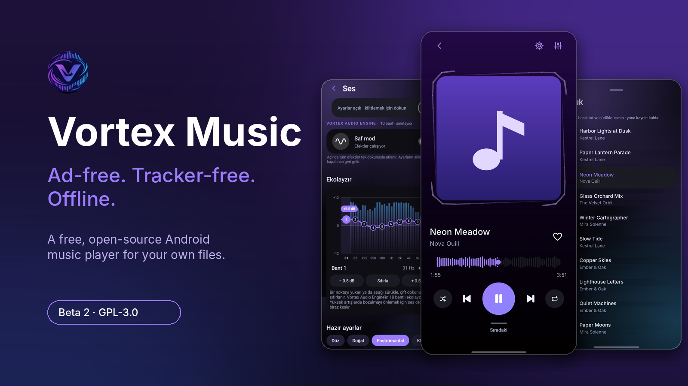
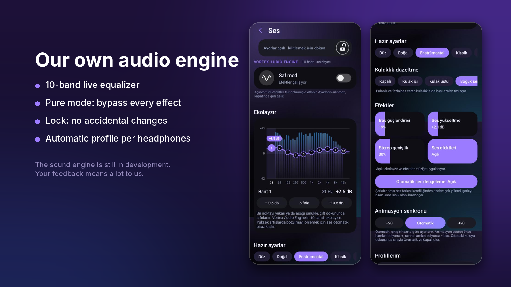
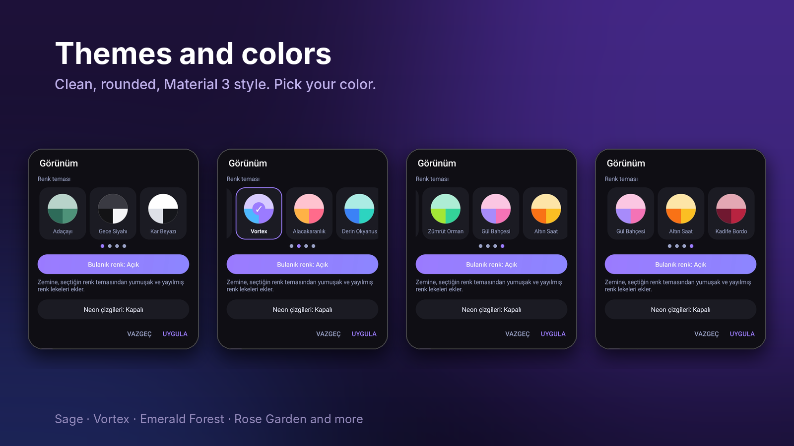
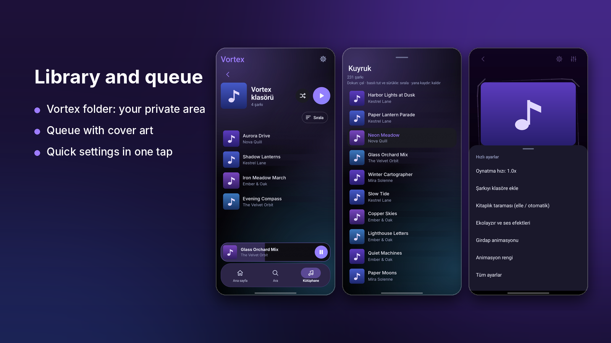
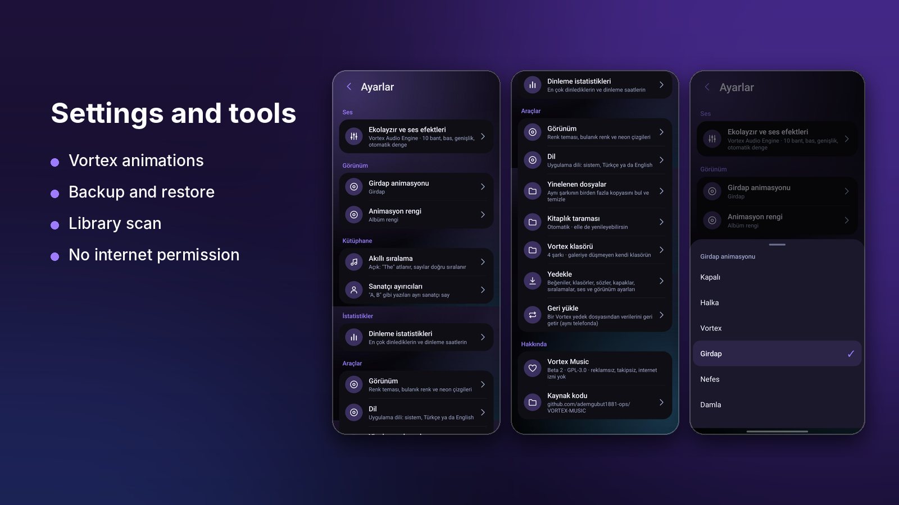
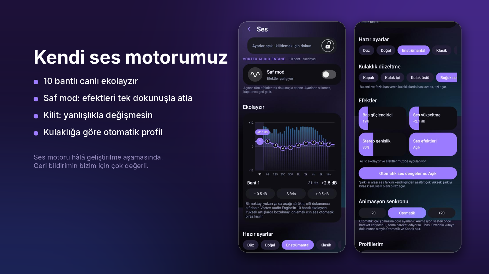
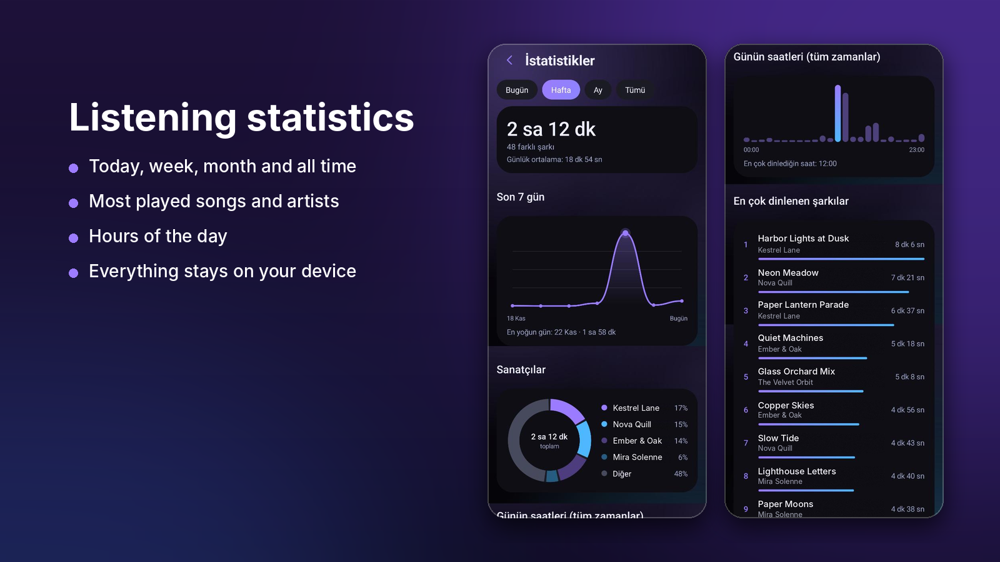
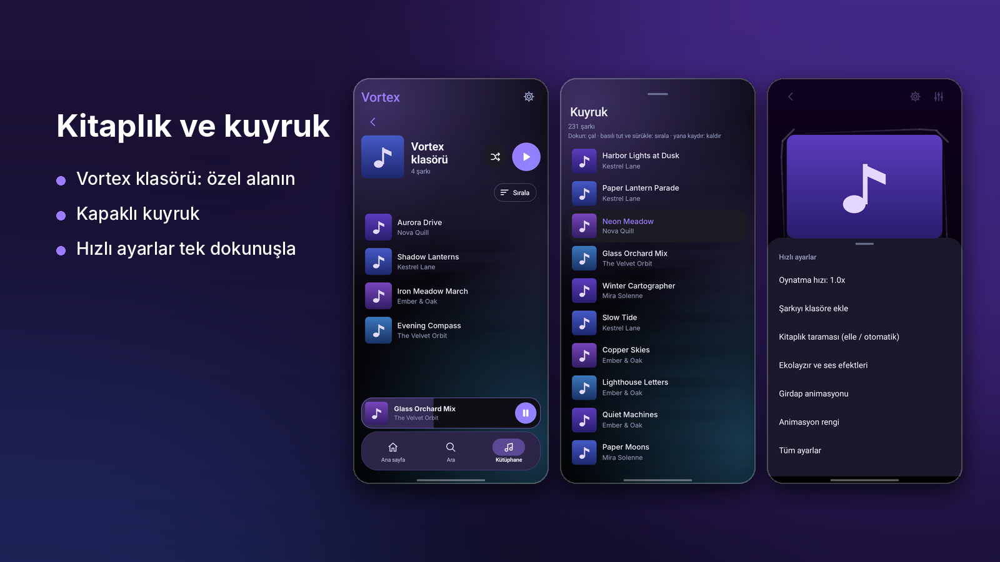
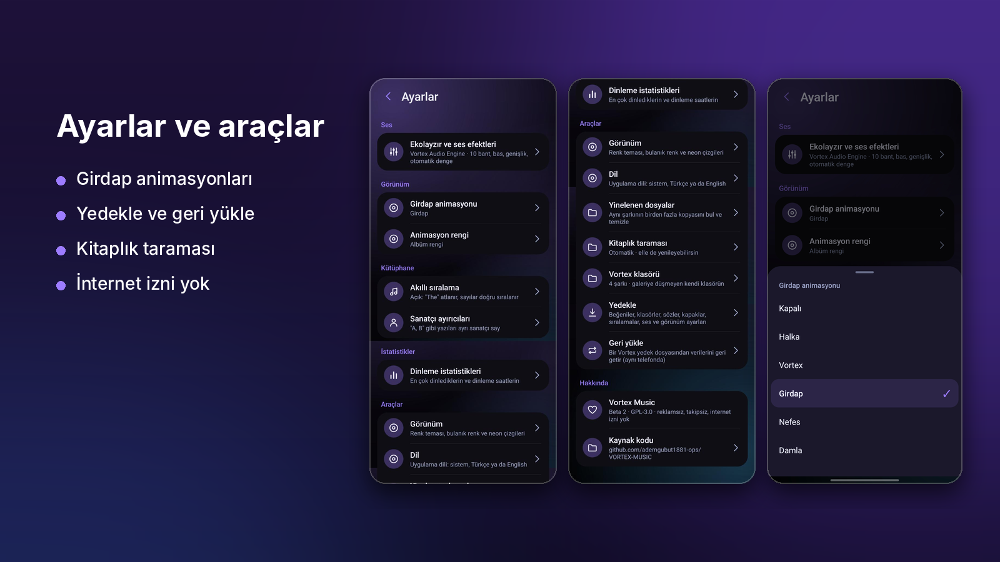

  

  <b>English</b> · <a href="#türkçe">Türkçe</a>

# Vortex Music

A free, open-source Android music player for **your own music files**.
No ads, no account, no tracking. It works fully offline and doesn't even ask for internet permission.

[**Download the latest beta**](../../releases) · [Report a bug](../../issues) · [What's new](CHANGELOG.md)

> **Status:** Beta 2 (in testing). The interface is available in Turkish and English.

> **About the sound:** the audio engine is still in development. Your feedback helps us a lot in shaping it, so please tell us how Vortex sounds on your headphones and speakers.

## Screenshots

## Features

**Sound**
- **Vortex Audio Engine:** our own audio processing. A 10-band equalizer you can drag on a live graph, harmonic bass, stereo width, loudness boost, automatic volume leveling and a limiter
- **Pure mode:** one switch that bypasses all effects, so you hear the file as it is. Its icon turns from a wavy line into a straight one
- **EQ lock:** a lock button on the audio screen. When locked, the screen fades and nothing can be changed by accident
- **Automatic EQ:** save profiles and have them applied when headphones or a Bluetooth device connects
- Plays what Android can decode: MP3, AAC, FLAC, OGG, Opus, WAV and M4A (varies by device)

**Look and feel**
- **Material 3 style** interface, built without any extra library, with bottom sheets and rounded surfaces
- **Vortex animation** around the album cover that moves with the music: Ring, Swirl, Vortex, Breath and Drop, in album color, Vortex purple or rainbow
- Themes: Sage, Night Black, Snow White and more, with optional blur and neon lines
- A clean **player screen**: big round play button, shuffle and repeat as round buttons, the like heart next to the title. The background follows the cover art, while the buttons and the wave bar stay Vortex purple
- A **quick settings** sheet on the player screen (the gear button): playback speed, add to folder, library scan, equalizer, animation settings and all settings
- A startup animation where the VORTEX letters are pulled into the V

**Library**
- **Your music, your rules:** many sort modes, six list and grid layouts, manual ordering that never touches your files
- **Queue** with cover art: swipe to remove, hold and drag to reorder, open it from the bottom of the player
- Artist grouping and artist separators, smart sorting (skips "The", sorts numbers correctly), custom album and artist covers
- **Vortex folder (experimental):** pick your own folder; music inside it stays out of the gallery and other music apps. It has its own row at the bottom of the library, so it never mixes into All songs, Artists or Albums, and you can still play, like and sort it. Add songs by copying, or drop files in with your file manager
- **Library scan:** rescan the Vortex folder by hand, or let it scan automatically when you open the app (quick settings and Settings)
- **Duplicate finder** that locates multiple copies of the same song

**Your data, on your device**
- **Listening statistics:** today, this week, this month and all time
- **Backup and restore** for likes, folders, covers, orderings and settings
- Remembers where you left off when the app is closed
- Media notification and lock screen controls

## Privacy

- No internet permission, no ads, no analytics, no account
- Your statistics and settings stay on your device
- The app only asks for what it needs: access to your music files, and optionally Bluetooth permission to read the output device name (for automatic EQ)

## Install

1. Open the [Releases](../../releases) page.
2. Download the `.apk` file under the latest release.
3. Open it on your phone. Android may ask you to allow installing from your browser or file manager.

### Automatic updates with Obtainium

[Obtainium](https://github.com/ImranR98/Obtainium) is a free app that tracks apps on GitHub and notifies you when a new version is released.

1. Install and open Obtainium.
2. In **Add app**, paste this repository's address (the address of this page in your browser).
3. Releases are currently **pre-releases (beta)**, so turn on **Include prereleases** on the add screen.
4. Tap **Add**. When a new version comes out, Obtainium tells you and you update with one tap.

## Roadmap

These are plans, not promises.

- **Beta 2:** testing and fixes, and tuning of the sound engine
- **Beta 3:** a headphone setup helper, ReplayGain support, tools to organize large music collections, more translations
- **Later:** tag editing and more

## Contributing

Bug reports and ideas are welcome. Open an [issue](../../issues) and include what happened, your phone model and your Android version.
For sound feedback, please also tell us your headphones or speaker, and whether you used Bluetooth. The audio engine is still being developed and your listening notes guide us.
The technical notes are in [TECHNICAL.md](TECHNICAL.md).

## License

Released under the GPL-3.0 license. See [LICENSE](LICENSE).

---

## Türkçe

  

**Kendi müzik dosyaların** için ücretsiz, açık kaynaklı bir Android müzik çalar.
Reklam yok, hesap yok, takip yok. Tamamen çevrimdışı çalışır, internet iznini bile istemez.

[**En son betayı indir**](../../releases) · [Hata bildir](../../issues) · [Yenilikler](CHANGELOG.md)

> **Durum:** Beta 2 (test aşamasında). Arayüz Türkçe ve İngilizce olarak kullanılabilir.

> **Ses hakkında:** ses motoru hâlâ geliştirilme aşamasındadır. Geri bildirimleriniz geliştirme sürecimizde bize çok yardımcı olacak. Vortex'in kulaklığınızda ve hoparlörünüzde nasıl duyulduğunu bize yazın.

### Ekran görüntüleri

### Özellikler

**Ses**
- **Vortex Audio Engine:** kendi ses işleme motorumuz. Canlı grafikte sürükleyebildiğin 10 bantlı ekolayzır, harmonik bas, stereo genişlik, ses yükseltme, otomatik ses dengeleme ve sınırlayıcı
- **Saf mod:** tek anahtarla bütün efektleri devre dışı bırakır, dosyayı olduğu gibi duyarsın. Simgesi dalgalı çizgiden dümdüz çizgiye döner
- **EQ kilidi:** ses ekranında bir kilit düğmesi. Kilitleyince ekran solar ve yanlışlıkla hiçbir şey değişmez
- **Otomatik EQ:** profillerini kaydet, kulaklık ya da Bluetooth cihazı bağlanınca kendiliğinden uygulansın
- Android'in çözebildiği her şeyi çalar: MP3, AAC, FLAC, OGG, Opus, WAV ve M4A (cihaza göre değişir)

**Görünüm**
- Ek kütüphane kullanmadan yapılmış **Material 3 tarzı** arayüz: alt sayfalar, yuvarlak yüzeyler
- Albüm kapağının çevresinde müzikle hareket eden **Vortex animasyonu**: Halka, Girdap, Vortex, Nefes ve Damla. Renk albümden, Vortex moru ya da gökkuşağı olabilir
- Temalar: Adaçayı, Gece Siyahı, Kar Beyazı ve daha fazlası; isteğe bağlı bulanıklık ve neon çizgileri
- Sade **oynatıcı ekranı:** büyük yuvarlak oynat düğmesi, yuvarlak Karıştır ve Döngü düğmeleri, şarkı adının yanında beğeni kalbi. Arka plan kapağa göre değişir, düğmeler ve dalga çubuğu Vortex moru kalır
- Oynatıcı ekranında **hızlı ayarlar** sayfası (dişli düğmesi): oynatma hızı, klasöre ekle, kitaplık taraması, ekolayzır, animasyon ayarları ve tüm ayarlar
- VORTEX harflerinin V'nin içine çekildiği açılış animasyonu

**Kitaplık**
- **Müziğin, senin kuralların:** çok sayıda sıralama, altı liste ve ızgara görünümü, dosyalarına dokunmayan elle sıralama
- Kapaklı **kuyruk**: yana kaydırarak kaldır, basılı tutup sürükleyerek sırala, oynatıcının altından aç
- Sanatçı gruplama ve ayırıcıları, akıllı sıralama ("The" atlama, sayıları doğru sıralama), özel albüm ve sanatçı kapakları
- **Vortex klasörü (deneysel):** kendi klasörünü seç; içindeki müzikler galeriye ve diğer müzik uygulamalarına düşmez. Kitaplığın en altında kendi satırı vardır, yani Tüm şarkılar, Sanatçılar ve Albümler'e karışmaz; yine de çalabilir, beğenebilir ve sıralayabilirsin. Şarkıları kopyalayarak ekle ya da dosya yöneticisiyle at
- **Kitaplık taraması:** Vortex klasörünü elle yeniden tara ya da uygulamayı açınca kendiliğinden taransın (hızlı ayarlar ve Ayarlar'da)
- Aynı şarkının birden fazla kopyasını bulan **yinelenen dosya aracı**

**Verin cihazında kalır**
- **Dinleme istatistikleri:** bugün, hafta, ay ve tüm zamanlar
- Beğeniler, klasörler, kapaklar, sıralamalar ve ayarlar için **yedekleme ve geri yükleme**
- Uygulama kapanınca kaldığın yeri hatırlar
- Medya bildirimi ve kilit ekranı kontrolleri

### Gizlilik

- İnternet izni yok, reklam yok, analiz yok, hesap yok
- İstatistiklerin ve ayarların cihazında kalır
- Uygulama sadece gerekeni ister: müzik dosyalarına erişim ve isteğe bağlı olarak çıkış cihazı adını okumak için Bluetooth izni (otomatik EQ için)

### Kurulum

1. [Releases](../../releases) sayfasını aç.
2. En son `.apk` dosyasını indir.
3. Telefonunda aç. Android, tarayıcından ya da dosya yöneticisinden yüklemeye izin vermeni isteyebilir.

Güncellemeleri [Obtainium](https://github.com/ImranR98/Obtainium) ile de takip edebilirsin: bu deponun adresini ekle, yeni sürüm çıkınca haber verir. Sürümler şimdilik **ön sürüm (beta)** olduğu için ekleme ekranında **Include prereleases** seçeneğini aç.

### Yol haritası

Bunlar plan, söz değil.

- **Beta 2:** test, düzeltmeler ve ses motorunun ayarlanması
- **Beta 3:** kulaklık kurulum yardımcısı, ReplayGain desteği, büyük müzik arşivlerini düzenleme araçları, daha fazla dil
- **Daha sonra:** etiket düzenleme ve daha fazlası

### Katkı

Hata bildirimleri ve fikirler memnuniyetle karşılanır. Bir [issue](../../issues) aç, ne olduğunu, telefon modelini ve Android sürümünü yaz.
Ses geri bildirimi verirken kulaklığını ya da hoparlörünü ve Bluetooth kullanıp kullanmadığını da yaz. Ses motoru hâlâ geliştiriliyor, dinleme notların bize yol gösterir.
Teknik notlar [TECHNICAL.md](TECHNICAL.md) içinde (Türkçesi: [TEKNIK_DOKUMAN.md](TEKNIK_DOKUMAN.md)).

### Lisans

GPL-3.0 lisansı ile yayınlanmıştır. [LICENSE](LICENSE) dosyasına bak.
