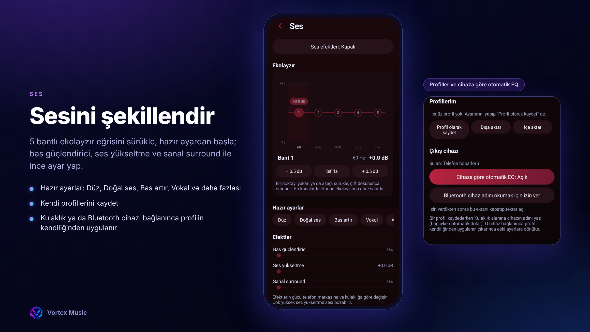
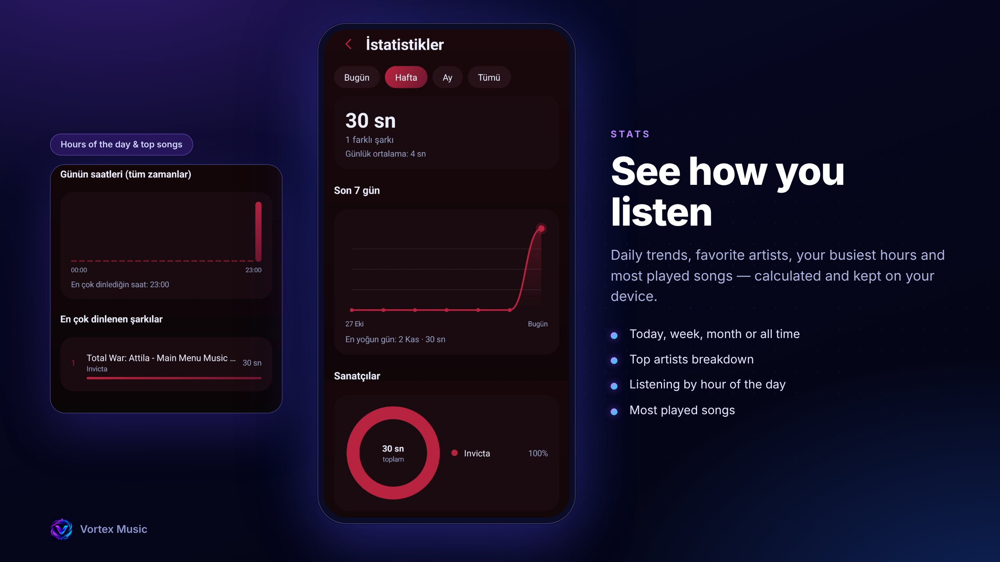
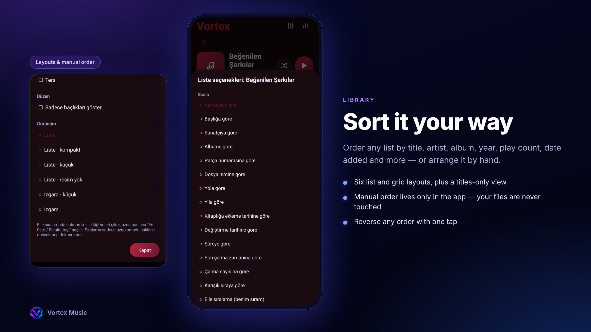
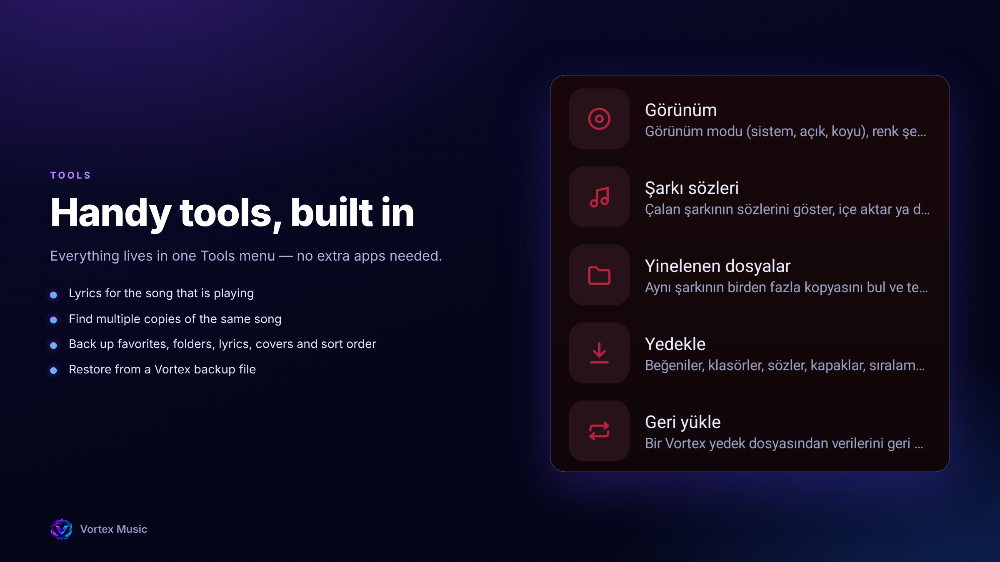

Vortex Music
Kendi müzik dosyaların için ücretsiz, açık kaynaklı bir Android müzik çalar.
Reklam yok, hesap yok, takip yok. Tamamen çevrimdışı çalışır, internet iznini bile istemez.
Durum: Beta. Uygulama şimdilik Türkçe. İngilizce, Fransızca, Almanca ve İtalyanca Beta 2 için planlandı.
Özellikler
Kendi dosyalarını çalar, medya bildirimi ve kilit ekranı kontrolleriyle
Ekolayzır: 5 bantlı sürüklenebilir eğri, hazır ayarlar, bas güçlendirici, ses yükseltme ve sanal surround
Otomatik EQ: profillerini kaydet, kulaklık ya da Bluetooth cihazı bağlanınca kendiliğinden uygulansın
Dinleme istatistikleri: bugün, hafta, ay ve tüm zamanlar, hepsi cihazında hesaplanır
Görünüm: açık, koyu ya da sistem modu, çok sayıda renk şeması, Android 12+ için dinamik renkler, isteğe bağlı bulanık renk ve neon çizgileri
Kitaplık kontrolü: çok sayıda sıralama, altı liste ve ızgara görünümü, dosyalarına dokunmayan elle sıralama
Çalan şarkının sözleri
Aynı şarkının birden fazla kopyasını bulan yinelenen dosya aracı
Beğeniler, klasörler, sözler, kapaklar ve sıralamayı yedekleme ve geri yükleme
Uygulama kapanınca kaldığın yeri hatırlar
Gizlilik
İnternet izni yok, reklam yok, analiz yok, hesap yok
İstatistiklerin, sözlerin ve ayarların cihazında kalır
Uygulama sadece gerekeni ister: müzik dosyalarına erişim ve isteğe bağlı olarak çıkış cihazı adını okumak için Bluetooth izni (otomatik EQ için)
Kurulum
Releases sayfasını aç.
En son sürümün altındaki .apk dosyasını indir.
Telefonunda aç. Android, tarayıcından ya da dosya yöneticisinden yüklemeye izin vermeni isteyebilir.
Obtainium ile otomatik güncelleme
Obtainium, GitHub'daki uygulamaları takip edip yeni sürüm çıkınca haber veren ücretsiz bir uygulamadır.
Obtainium'u kur, aç.
Uygulama ekle bölümüne bu deponun adresini yapıştır (tarayıcında bu sayfanın adresi).
Şu an sürümler ön sürüm (beta) olduğu için, uygulama ekle ekranında Ön sürümleri dahil et seçeneğini aç.
Ekle'ye dokun. Yeni sürüm çıktığında Obtainium sana haber verir, tek dokunuşla güncellersin.
Yol haritası
Beta 2: İngilizce, Fransızca, Almanca ve İtalyanca çeviriler, Hakkında ve Yenilikler ekranı, daha fazla tema seçeneği
Daha sonra: etiket düzenleme, yeni özellikler
Katkı
Hata bildirimleri ve fikirler memnuniyetle karşılanır. Bir issue aç, ne olduğunu, telefon modelini ve Android sürümünü yaz.
Lisans
GPL-3.0 lisansı ile yayınlanmıştır. LICENSE dosyasına bak.

## Screenshots

### 01 — Vortex Music

### 02 — Sound

### 03 — Statistics

### 04 — Appearance

### 05 — Music Library

### 06 — Tools

